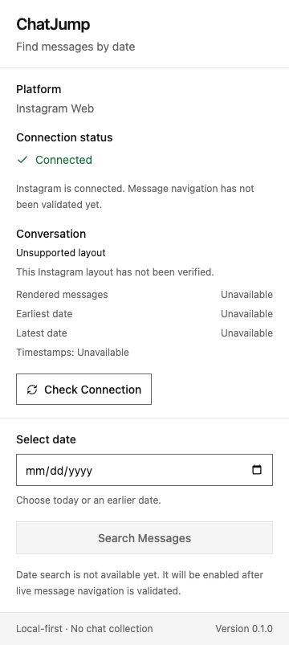

# ChatJump

A local-first Chrome extension for finding messages by date. **Version 0.1.0 includes the Phase 1 foundation and Phase 2 detection pipeline:** an installable Manifest V3 extension, a React popup, typed messaging, and a configurable adapter for currently rendered conversation metadata.

**Historical date search is disabled. Live Instagram compatibility is UNVERIFIED.** No reliable live selectors were available from Phase 0. Production therefore uses an explicitly unverified profile: an Instagram DM route reports an unsupported layout and unavailable counts until manually inspected selectors are configured. A successful connection means the content script answered; it does not establish conversation detection.



This is an actual action-popup screenshot from Chromium 156.0.8078.4. The page behind it was a controlled synthetic fixture, with no logged-in account or private messages.

## Install and run

Use Node 22.13+ within Node 22, Node 24, or Node 26+, with npm.

```sh
npm ci
npm run dev
```

The project follows the official WXT React starter and uses WXT, React, strict TypeScript, Tailwind CSS 4's Vite plugin, Lucide React, Vitest, React Testing Library, and native Chrome runtime messaging. There is no application backend.

Commands:

| Command | Purpose |
|---|---|
| `npm run dev` | Start WXT development server and browser runner |
| `npm run build` | Build the production Chrome MV3 extension |
| `npm run zip` | Package the extension for distribution |
| `npm run typecheck` | Generate WXT types and run strict TypeScript checks |
| `npm run lint` | Lint application, configuration, and TypeScript tests |
| `npm test` | Run Phase 1 and Phase 2 unit/UI tests |
| `npm run check` | Typecheck, lint, test, then build |
| `npm run test:browser` | Test the production extension in isolated Chromium |
| `npm run test:browser:phase2` | Test a separately configured synthetic adapter in a native isolated world |
| `npm run test:dev` | Check a running development popup and React hot reload |
| `npm run test:phase0` | Run the preserved, separately installed Phase 0 checks |

For reproducible checks of both projects:

```sh
npm ci
npm --prefix phase0 ci
npm run check
npm run test:phase0
```

`npm install` can be used for initial dependency setup; `npm ci` uses the committed lockfiles. Build outputs, dependency directories, and generated test artifacts are ignored by Git.

## Load into Chrome

1. Run `npm run build`.
2. Open `chrome://extensions` and enable Developer mode.
3. Select **Load unpacked**, then choose **`.output/chrome-mv3`** from this repository. This exact output directory and its manifest were verified from the production build.
4. Pin ChatJump in the toolbar.
5. Open `https://www.instagram.com/`. Log in manually if needed; ChatJump never automates login.
6. Reload the Instagram tab after installing or reloading the extension, then click ChatJump and use **Check Connection**.

The popup displays Connected only after receiving the expected response from the top-frame content script. An old tab without the current content script shows an actionable error. Unsupported sites and inaccessible/restricted tabs are handled separately. Selecting a valid date does not enable historical search in this phase.

Development output is **`.output/chrome-mv3-dev`**, verified from WXT's running development server. Keep the server running when loading that directory. If your Chrome channel does not support the automatic development runner, start without opening a browser:

```sh
CHATJUMP_NO_BROWSER=1 npm run dev
```

Then load `.output/chrome-mv3-dev` manually through Chrome's extension page. The environment-variable syntax above is for macOS/Linux; on Windows, set `CHATJUMP_NO_BROWSER=1` using your shell's syntax. WXT owns development reload tooling; production does not include it.

## Permissions and privacy

The **production** manifest requests only:

| Capability | Purpose |
|---|---|
| `activeTab` | Temporary access to the active tab's URL after the user invokes ChatJump; avoids broad `tabs` permission |
| Declarative content script matching `https://www.instagram.com/*` | Install the connection listener and DOM adapter on Instagram Web only |

There are no production `host_permissions`, `scripting`, `tabs`, cookies, webRequest, history, downloads, storage, WhatsApp access, or `<all_urls>` declarations. Content-script matching is itself site access; it is not access to every website. The bare `instagram.com` origin is outside the declared scope; open the `www` origin.

WXT's **development-only** generated manifest adds `tabs`, `scripting`, matching Instagram/localhost host permissions, a reload command, a service worker, and localhost CSP entries for its reload/HMR implementation. Those are framework tooling used for development injection and reloading. They are absent from the verified production manifest. Never distribute the development build.

ChatJump reads date metadata only from explicitly verified message/date structures. It does not extract message bodies or media, collect participants, read tokens/cookies/passwords, intercept website requests, persist chat data, or send anything to a server. DOM references and opaque identities remain transient within the content script. Only whitelisted serializable metadata reaches the popup. Browser errors use fixed messages without private URLs or raw stack traces. Browser automation uses disposable profiles and synthetic documents.

## Architecture and messaging

The production extension has two entrypoints: the popup and the Instagram content script. There is **no production background worker** because this phase has no responsibility requiring one. The popup talks directly to the content script; no long-lived background state is assumed.

1. `useActiveTab` queries the active tab through a narrow browser-client interface.
2. `platformDetection` validates the URL origin. A DM route is only a route candidate, never proof of a rendered conversation.
3. `messagingService` sends a typed `GET_CONNECTION_STATUS` message to frame 0 and validates the response shape. `PING` uses the same schema.
4. The content listener accepts recognized messages only from this extension's UI, checks the page origin, and responds when initialized.
5. The Phase 1 response remains `{ success: true, platform: 'instagram', contentScriptReady: true, conversationDetected: null }`. This handshake intentionally makes no conversation claim.
6. The popup rechecks the active tab before accepting a response, cancels obsolete work on tab updates/activation/removal, and releases subscriptions when it closes.

After connecting, `useConversationSnapshot` requests `GET_RENDERED_MESSAGE_SUMMARY` (or callers can use `GET_CONVERSATION_STATUS`). The content script reads the adapter afresh and both ends validate its snapshot. The popup requests updates sequentially while open and rejects responses for a changed active tab. Individual browser operations have 2-second deadlines. Late replies cannot replace newer state. No search messages or fake search results are defined.

`ChatAdapter` separates DOM logic from React. The Instagram implementation centralizes manually verified selectors, detects a unique root/list/identity, deduplicates rendered message containers, parses strict timestamps, associates validated date groups, and reads scroll geometry without scrolling. One scoped MutationObserver coalesces changes over 100ms; a 500ms identity check catches route/root replacement. Switching conversations discards old references. Cleanup disconnects observers, timers, listeners, and messaging on WXT context invalidation.

Snapshots contain status, reliable rendered/visible/dated counts, detected calendar range, timezone, coverage, revision, and fixed diagnostics. Uncertain counts are omitted. “Complete” means all currently rendered messages have dates; full-history completeness remains unknown. The calendar timezone must be independently verified against Instagram's display, rather than copied from the popup's timezone.

See [the complete source tree and file inventory](docs/architecture.md) and [Phase 2 implementation, selector calibration, timestamp/grouping rules, manual verification, and limitations](docs/phase2-implementation.md).

## Tests and screenshots

The extension has **126 passing tests across 13 files**, including the existing 56 Phase 1 tests and 70 new Phase 2 tests. The preserved Phase 0 has **123 passing tests across 9 files** plus its bundle smoke test. Strict compilation, linting, and the production build pass.

To run the actual extension-browser checks:

```sh
npx playwright install chromium
npm run build
npm run test:browser
npm run test:browser:phase2
```

The production harness uses Chromium's developer extension-loading/action APIs in a disposable profile, fulfills a synthetic Instagram-origin document, and blocks outside network requests. It verifies the real toolbar popup, runtime handshake, unavailable Phase 2 metadata on unverified layouts, date input, unsupported sites, reload/reinstall recovery, keyboard focus, square buttons, absence of gradients, and a 360px native layout. A 320px layout uses the built popup document in a regular extension tab because native action popups do not support viewport emulation. Runtime APIs and content-script responses are not mocked in this browser test.

The separate Phase 2 browser harness builds a test-only adapter with synthetic selectors, then runs it in a native isolated execution world. It verifies message/date detection, insertion/removal, conversation switching, unchanged scroll position, serialization, and cleanup. Test selectors never enter the production bundle. Both harnesses passed in Chromium 156.0.8078.4; neither validates a live Instagram account.

Generated results and screenshots are written to `artifacts/`. Selected actual screenshots are included in `docs/images/`. These are foundation tests against a synthetic page, not live Instagram DOM validation.

For the hot-reload test, run the development server in one terminal:

```sh
CHATJUMP_NO_BROWSER=1 npm run dev -- --port 3097
```

Then run `npm run test:dev` in another terminal. It loads the development extension into disposable Chromium, checks React rendering, temporarily changes the header text, verifies the rendered update, restores the original source, and verifies restoration. Avoid editing `Header.tsx` concurrently with that test. Development rendering and React HMR passed during Phase 1; that separate development test was not rerun during Phase 2.

The [Phase 1 validation report](docs/phase1-validation.md) records actual evidence, the remaining manual scenarios, and limitations. Live testing with a developer-owned logged-in Instagram account is still **NOT TESTED**.

## Design and phase boundaries

The popup uses only solid approved palette colors, zero-radius rectangular buttons, a native labeled date input, visible keyboard focus, readable disabled states, and a compact layout. It has no gradients, animation, blur, decorative shadows, or third-party component library. Contrast tests cover the actual foreground/background tokens. Native date-picker internals belong to Chrome and follow its locale.

Phase 0 files and history are preserved unchanged. Phase 2 reuses its strict timestamp/calendar/range helpers and sanitized DOM inspector. Its unverified scrolling/search engine is not imported into the extension. Read the [Phase 0 report](phase0/reports/feasibility-report.md) before evaluating date navigation.

Phase 2's configurable implementation is tested against synthetic layouts. Before Phase 3, manually calibrate and verify live root/message selectors, conversation identity, timestamp timezone and associations, date-group order, scroll container, older-history direction, and virtualization behavior. Follow the [Phase 2 manual scenarios](docs/phase2-implementation.md#manual-chrome-validation) and [Phase 0 protocol](phase0/README.md). Phase 3 has not started; live calibration remains its prerequisite.

References: [WXT setup](https://wxt.dev/guide/installation.html), [Tailwind's Vite integration](https://tailwindcss.com/docs/installation/using-vite), [Chrome activeTab](https://developer.chrome.com/docs/extensions/develop/concepts/activeTab), and [Chrome DevTools extension testing APIs](https://chromedevtools.github.io/devtools-protocol/tot/Extensions/).
