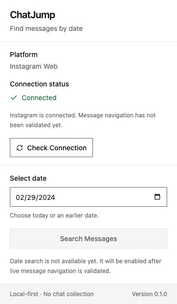

# ChatJump

A local-first Chrome extension foundation for finding messages by date. **Version 0.1.0 implements Phase 1:** an installable Manifest V3 extension, a React popup, date selection, and a real popup-to-content-script connection check.

**Historical date search is disabled.** Phase 0's live navigation feasibility remains **UNVERIFIED**. A successful connection means the content script answered; it does not mean a conversation was detected or messages can be searched. Phase 2 has not started.



This is an actual action-popup screenshot from Chromium 156.0.8078.4. The page behind it was a controlled synthetic fixture, with no logged-in account or private messages.

## Install and run

Use Node 22.13+ within Node 22, Node 24, or Node 26+, with npm.

```sh
npm ci
npm run dev
```

The project follows the official WXT React starter and uses WXT, React, strict TypeScript, Tailwind CSS 4's Vite plugin, Lucide React, Vitest, React Testing Library, and native Chrome runtime messaging. There is no application backend.

Commands:

| Command | Purpose |
|---|---|
| `npm run dev` | Start WXT development server and browser runner |
| `npm run build` | Build the production Chrome MV3 extension |
| `npm run zip` | Package the extension for distribution |
| `npm run typecheck` | Generate WXT types and run strict TypeScript checks |
| `npm run lint` | Lint application, configuration, and TypeScript tests |
| `npm test` | Run Phase 1 unit/UI tests |
| `npm run check` | Typecheck, lint, test, then build |
| `npm run test:browser` | Test the production extension in isolated Chromium |
| `npm run test:dev` | Check a running development popup and React hot reload |
| `npm run test:phase0` | Run the preserved, separately installed Phase 0 checks |

For reproducible checks of both projects:

```sh
npm ci
npm --prefix phase0 ci
npm run check
npm run test:phase0
```

`npm install` can be used for initial dependency setup; `npm ci` uses the committed lockfiles. Build outputs, dependency directories, and generated test artifacts are ignored by Git.

## Load into Chrome

1. Run `npm run build`.
2. Open `chrome://extensions` and enable Developer mode.
3. Select **Load unpacked**, then choose **`.output/chrome-mv3`** from this repository. This exact output directory and its manifest were verified from the production build.
4. Pin ChatJump in the toolbar.
5. Open `https://www.instagram.com/`. Log in manually if needed; ChatJump never automates login.
6. Reload the Instagram tab after installing or reloading the extension, then click ChatJump and use **Check Connection**.

The popup displays Connected only after receiving the expected response from the top-frame content script. An old tab without the current content script shows an actionable error. Unsupported sites and inaccessible/restricted tabs are handled separately. Selecting a valid date does not enable historical search in this phase.

Development output is **`.output/chrome-mv3-dev`**, verified from WXT's running development server. Keep the server running when loading that directory. If your Chrome channel does not support the automatic development runner, start without opening a browser:

```sh
CHATJUMP_NO_BROWSER=1 npm run dev
```

Then load `.output/chrome-mv3-dev` manually through Chrome's extension page. The environment-variable syntax above is for macOS/Linux; on Windows, set `CHATJUMP_NO_BROWSER=1` using your shell's syntax. WXT owns development reload tooling; production does not include it.

## Permissions and privacy

The **production** manifest requests only:

| Capability | Purpose |
|---|---|
| `activeTab` | Temporary access to the active tab's URL after the user invokes ChatJump; avoids broad `tabs` permission |
| Declarative content script matching `https://www.instagram.com/*` | Install the connection listener on Instagram Web only |

There are no production `host_permissions`, `scripting`, `tabs`, cookies, webRequest, history, downloads, storage, WhatsApp access, or `<all_urls>` declarations. Content-script matching is itself site access; it is not access to every website. The bare `instagram.com` origin is outside the declared scope; open the `www` origin.

WXT's **development-only** generated manifest adds `tabs`, `scripting`, matching Instagram/localhost host permissions, a reload command, a service worker, and localhost CSP entries for its reload/HMR implementation. Those are framework tooling used for development injection and reloading. They are absent from the verified production manifest. Never distribute the development build.

ChatJump does not scrape messages, collect participants, read tokens/cookies/passwords, intercept website requests, persist chat data, or send anything to a server. The popup's date and connection state are temporary in-memory values. Browser errors are mapped to fixed user-facing messages, with no private URLs or raw stack traces. Browser automation uses an isolated disposable profile with synthetic documents, never your personal Chrome profile.

## Architecture and messaging

The production extension has two entrypoints: the popup and the Instagram content script. There is **no production background worker** because this phase has no responsibility requiring one. The popup talks directly to the content script; no long-lived background state is assumed.

1. `useActiveTab` queries the active tab through a narrow browser-client interface.
2. `platformDetection` validates the URL origin. A DM route is only a route candidate, never proof of a rendered conversation.
3. `messagingService` sends a typed `GET_CONNECTION_STATUS` message to frame 0 and validates the response shape. `PING` uses the same schema.
4. The content listener accepts recognized messages only from this extension's UI, checks the page origin, and responds when initialized.
5. The response is `{ success: true, platform: 'instagram', contentScriptReady: true, conversationDetected: null }`. Conversation detection remains explicitly unknown.
6. The popup rechecks the active tab before accepting a response, cancels obsolete work on tab updates/activation/removal, and releases subscriptions when it closes.

Individual tab queries and messages have 2-second deadlines. Late replies cannot replace newer state. Missing scripts, rejected messages, malformed responses, no active tab, missing URLs, and timeouts have actionable messages. No search messages or fake search results are defined.

Code layout and the full file inventory are in [docs/architecture.md](docs/architecture.md). The main boundaries are `entrypoints/`, `src/components/`, `src/hooks/`, `src/messaging/`, `src/services/`, `src/adapters/instagram/`, and `src/utils/`. Platform-specific DOM logic remains isolated in `phase0/`.

## Tests and screenshots

Phase 1 has **56 passing automated tests across 5 files**. The preserved Phase 0 has **123 passing tests across 9 files** plus its bundle smoke test. Strict compilation, linting, and the production build pass.

To run the actual extension-browser checks:

```sh
npx playwright install chromium
npm run build
npm run test:browser
```

The harness uses Chromium's developer extension-loading/action APIs in a disposable profile, fulfills a synthetic Instagram-origin document, and blocks outside network requests. It verifies the real toolbar popup, actual runtime handshake, date input, unsupported sites, tab reload, extension reinstall/recovery, keyboard focus, square buttons, absence of gradients, and a 360px native layout. A 320px layout is checked using the same built popup document in a regular extension tab because native action popups do not support viewport emulation. Runtime APIs and content-script responses are not mocked in this browser test.

Generated results and screenshots are written to `artifacts/`. Selected actual screenshots are included in `docs/images/`. These are foundation tests against a synthetic page, not live Instagram DOM validation.

For the hot-reload test, run the development server in one terminal:

```sh
CHATJUMP_NO_BROWSER=1 npm run dev -- --port 3097
```

Then run `npm run test:dev` in another terminal. It loads the development extension into disposable Chromium, checks React rendering, temporarily changes the header text, verifies the rendered update, restores the original source, and verifies restoration. Avoid editing `Header.tsx` concurrently with that test. Both development rendering and actual React HMR passed here.

The [Phase 1 validation report](docs/phase1-validation.md) records actual evidence, the remaining manual scenarios, and limitations. Live testing with a developer-owned logged-in Instagram account is still **NOT TESTED**.

## Design and phase boundaries

The popup uses only solid approved palette colors, zero-radius rectangular buttons, a native labeled date input, visible keyboard focus, readable disabled states, and a compact layout. It has no gradients, animation, blur, decorative shadows, or third-party component library. Contrast tests cover the actual foreground/background tokens. Native date-picker internals belong to Chrome and follow its locale.

Phase 0 files and history are preserved unchanged. Only the pure `validDateISO` utility is reused; its unverified scrolling/search engine is not imported into the extension. Read the [Phase 0 report](phase0/reports/feasibility-report.md) before evaluating date navigation.

Phase 1 provides a tested extension foundation. Before enabling historical search in a later phase, manually establish a reliable live conversation identity, timestamp associations, older-history direction, virtualization behavior, and date-navigation results using the [Phase 0 manual protocol](phase0/README.md). Phase 2 is not implemented and does not start automatically.

References: [WXT setup](https://wxt.dev/guide/installation.html), [Tailwind's Vite integration](https://tailwindcss.com/docs/installation/using-vite), [Chrome activeTab](https://developer.chrome.com/docs/extensions/develop/concepts/activeTab), and [Chrome DevTools extension testing APIs](https://chromedevtools.github.io/devtools-protocol/tot/Extensions/).
